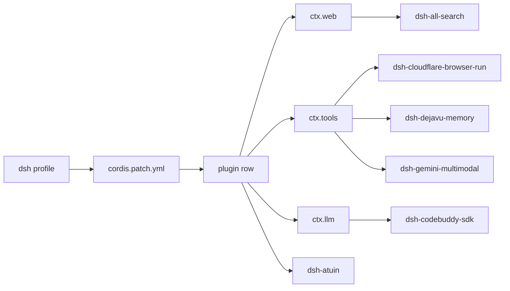

# dsh-plugins

[English](README.md) · [中文](README.zh.md)

Plugins for [DeepSeek Harness](https://github.com/deepseek-ai/deepseek-harness) (`dsh`). Each package is a Cordis plugin under `packages/`, with its own npm name and version.

DeepSeek Harness is text-first. These plugins add the services the host does not ship: web search, a remote browser, shell-history recording, long-term memory, multimodal tools, and one extra LLM provider.

## Packages

| package | version | npm | what it adds |
| --- | --- | --- | --- |
| [`dsh-all-search`](packages/dsh-all-search) | 0.2.14 | [`dsh-all-search`](https://www.npmjs.com/package/dsh-all-search) | Search provider `anysearch` on `ctx.web`. AnySearch, optional Firecrawl, optional TinyFish. |
| [`dsh-atuin`](packages/dsh-atuin) | 0.1.6 | [`dsh-atuin`](https://www.npmjs.com/package/dsh-atuin) | Appends each typed prompt to a local [atuin](https://github.com/atuinsh/atuin) history. |
| [`dsh-cloudflare-browser-run`](packages/dsh-cloudflare-browser-run) | 0.2.8 | [`dsh-cloudflare-browser-run`](https://www.npmjs.com/package/dsh-cloudflare-browser-run) | Tools `browse`, `screenshot`, `pdf`, `crawl`, `crawl_status` via Cloudflare Browser Run. |
| [`dsh-codebuddy-sdk`](packages/dsh-codebuddy-sdk) | 0.1.1 | [`dsh-codebuddy-sdk`](https://www.npmjs.com/package/dsh-codebuddy-sdk) | LLM adapter on `ctx.llm` for the local CodeBuddy CLI. |
| [`dsh-dejavu-memory`](packages/dsh-dejavu-memory) | 0.5.2 | [`dsh-dejavu-memory`](https://www.npmjs.com/package/dsh-dejavu-memory) | Tools `dejavu_boot`, `dejavu_read`, `dejavu_search`, `dejavu_create`, `dejavu_update`, `dejavu_delete`. |
| [`dsh-gemini-multimodal`](packages/dsh-gemini-multimodal) | 0.1.6 | [`dsh-gemini-multimodal`](https://www.npmjs.com/package/dsh-gemini-multimodal) | Tools `media_understand`, `media_transcribe`, `image_generate`, `read_document`. |

Versions match `packages/<name>/package.json` in this tree. Each package has its own [English](packages/dsh-all-search/README.md) and [Chinese](packages/dsh-all-search/README.zh.md) README (same paths under the other packages).

Every package is MIT. There is no root `LICENSE`; the grant is the file inside the package you install.

## How a plugin fits

A profile lists the package. The package's `cordis.patch.yml` inserts one plugin row. The plugin then registers on the host service it depends on.



`dsh-atuin` does not register a tool. It listens for `session/event` of type `user/message` and runs `atuin history start` / `atuin history end`.

| package | host surface | outside the process |
| --- | --- | --- |
| `dsh-all-search` | `ctx.web` search provider `anysearch` | AnySearch MCP, Firecrawl, TinyFish |
| `dsh-atuin` | `session/event` | local `atuin` binary |
| `dsh-cloudflare-browser-run` | `ctx.tools` | Cloudflare Browser Run API |
| `dsh-codebuddy-sdk` | `ctx.llm` adapter | local `codebuddy` CLI |
| `dsh-dejavu-memory` | `ctx.tools` | your DejaVu MCP server |
| `dsh-gemini-multimodal` | `ctx.tools` | Gemini REST, or local `agy` |

## Install

Node `>=20` for every package except `dsh-codebuddy-sdk`, which does not set `engines`. Install into a Harness profile:

```sh
dsh plugin --profile web add dsh-all-search
dsh plugin --profile web add dsh-atuin
dsh plugin --profile web add dsh-cloudflare-browser-run
dsh plugin --profile web add dsh-dejavu-memory
dsh plugin --profile web add dsh-gemini-multimodal
dsh plugin add dsh-codebuddy-sdk
```

Keys and endpoints go in the profile row that overrides the inserted plugin. The patch files insert the row without credentials. Example for the browser plugin:

```yaml
- id: cloudflare-browser-run
  name: dsh-cloudflare-browser-run
  config:
    cf_api_token: <your token>
    cf_account_id: <your account id>
```

Option tables, required binaries, and privacy notes are in each package README.

## Develop

There is no root `package.json`. Work inside one package:

```bash
cd packages/<pkg>
npm ci
npm run typecheck
npm test
npm run build
```

`dsh-codebuddy-sdk` also has `npm run test:ci` (unit tests, no CLI) and `npm run test:integration` (needs a signed-in `codebuddy` CLI and `CODEBUDDY_SDK_INTEGRATION=1`). `dsh-gemini-multimodal` has `npm run test:ci`, which runs the smoke test only.

Root CI (`.github/workflows/ci.yml`) runs on `main`, on pull requests, and on `workflow_dispatch`. It typechecks and tests only the packages whose files changed. Node 26.

## Release

Tag the current commit with the version already written in that package's `package.json`:

```bash
script/release-tag.sh <pkg>
git push origin <pkg>-v<version>
```

`script/release-tag.sh dsh-all-search` reads `packages/dsh-all-search/package.json` and creates `dsh-all-search-v0.2.14` when that file says `0.2.14`. The tag does not bump the version.

`.github/workflows/publish.yml` matches `dsh-*-v*`, checks the tag version against `package.json`, builds that package, and runs `npm publish --access public` with OIDC. No npm token is stored in the repo.

Each package also still has a nested `.github/workflows/publish.yml` that matches a bare `v*` tag. Those files are leftovers from when the packages were separate repositories. A `dsh-<pkg>-v<version>` tag does not match them. Release from this monorepo with the root workflow.

## License

MIT, per package. See `packages/<name>/LICENSE`.
