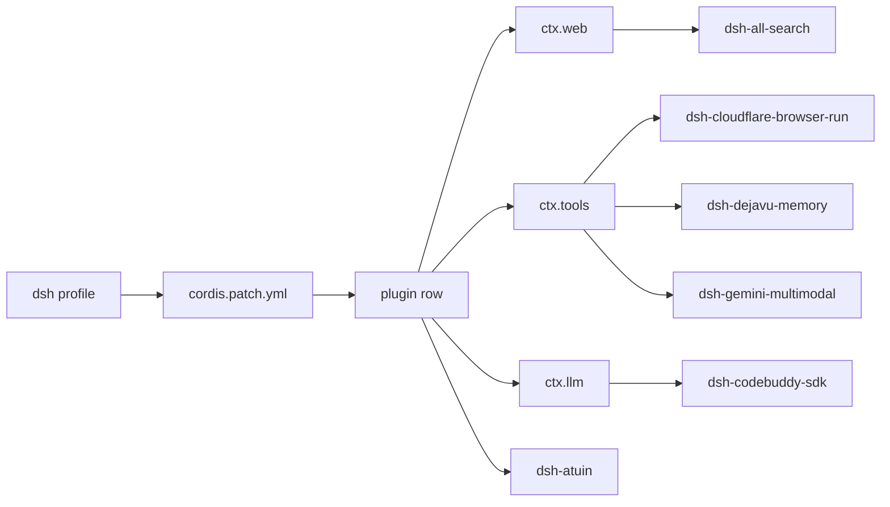

# dsh-plugins

[中文](README.zh.md) · [English](README.md)

[DeepSeek Harness](https://github.com/deepseek-ai/deepseek-harness)（`dsh`）的插件集。每个包都是 `packages/` 下的一个 Cordis 插件，保留自己的 npm 名和版本。

DeepSeek Harness 以文本为主。这些插件补上宿主未自带的能力：网页搜索、远程浏览器、shell 历史记录、长期记忆、多模态工具，以及一个额外的 LLM 提供方。

## 包

| 包 | 版本 | npm | 补充的能力 |
| --- | --- | --- | --- |
| [`dsh-all-search`](packages/dsh-all-search) | 0.2.20 | [`dsh-all-search`](https://www.npmjs.com/package/dsh-all-search) | 在 `ctx.web` 上注册搜索提供方 `anysearch`。可走 AnySearch，也可选 Firecrawl 和 TinyFish。 |
| [`dsh-atuin`](packages/dsh-atuin) | 0.1.8 | [`dsh-atuin`](https://www.npmjs.com/package/dsh-atuin) | 把每条手输提示追加到本机 [atuin](https://github.com/atuinsh/atuin) 历史。 |
| [`dsh-cloudflare-browser-run`](packages/dsh-cloudflare-browser-run) | 0.2.13 | [`dsh-cloudflare-browser-run`](https://www.npmjs.com/package/dsh-cloudflare-browser-run) | 工具 `browse`、`screenshot`、`pdf`、`crawl`、`crawl_status`，走 Cloudflare Browser Run。 |
| [`dsh-codebuddy-sdk`](packages/dsh-codebuddy-sdk) | 0.1.7 | [`dsh-codebuddy-sdk`](https://www.npmjs.com/package/dsh-codebuddy-sdk) | 在 `ctx.llm` 上注册本机 CodeBuddy CLI 的 LLM 适配器。 |
| [`dsh-dejavu-memory`](packages/dsh-dejavu-memory) | 0.5.8 | [`dsh-dejavu-memory`](https://www.npmjs.com/package/dsh-dejavu-memory) | 工具 `dejavu_boot`、`dejavu_read`、`dejavu_search`、`dejavu_create`、`dejavu_update`、`dejavu_delete`。 |
| [`dsh-gemini-multimodal`](packages/dsh-gemini-multimodal) | 0.1.11 | [`dsh-gemini-multimodal`](https://www.npmjs.com/package/dsh-gemini-multimodal) | 工具 `media_understand`、`media_transcribe`、`image_generate`、`read_document`。 |

版本与本仓库 `packages/<name>/package.json` 一致。每个包都有英文和中文 README，例如 `packages/dsh-all-search/README.md` 与 `README.zh.md`。

每个包都是 MIT。根目录没有 `LICENSE`；授权以你安装的那个包里的文件为准。

## 插件怎么接上去

profile 列出要加载的包。包里的 `cordis.patch.yml` 插入一行插件。插件再注册到它依赖的宿主服务上。



`dsh-atuin` 不注册工具。它监听类型为 `user/message` 的 `session/event`，然后执行 `atuin history start` / `atuin history end`。

| 包 | 宿主接口 | 进程之外 |
| --- | --- | --- |
| `dsh-all-search` | `ctx.web` 搜索提供方 `anysearch` | AnySearch MCP、Firecrawl、TinyFish |
| `dsh-atuin` | `session/event` | 本机 `atuin` 二进制 |
| `dsh-cloudflare-browser-run` | `ctx.tools` | Cloudflare Browser Run API |
| `dsh-codebuddy-sdk` | `ctx.llm` 适配器 | 本机 `codebuddy` CLI |
| `dsh-dejavu-memory` | `ctx.tools` | 你自己的 DejaVu MCP 服务 |
| `dsh-gemini-multimodal` | `ctx.tools` | Gemini REST，或本机 `agy` |

## 安装

除 `dsh-codebuddy-sdk` 未声明 `engines` 外，其余包要求 Node `>=20`。装进 Harness profile：

```sh
dsh plugin --profile web add dsh-all-search
dsh plugin --profile web add dsh-atuin
dsh plugin --profile web add dsh-cloudflare-browser-run
dsh plugin --profile web add dsh-dejavu-memory
dsh plugin --profile web add dsh-gemini-multimodal
dsh plugin add dsh-codebuddy-sdk
```

密钥和端点写在覆盖该插件行的 profile 里。patch 文件只插入行，不带凭证。浏览器插件的例子：

```yaml
- id: cloudflare-browser-run
  name: dsh-cloudflare-browser-run
  config:
    cf_api_token: <your token>
    cf_account_id: <your account id>
```

各项配置、依赖的本机程序和隐私说明在各包 README 里。

## 开发

进单个包工作（每个包仍有自己的 lockfile）：

```bash
cd packages/<pkg>
npm ci
npm run typecheck
npm test
npm run build
```

根目录 `package.json` 为 private，只为让 [Changesets](https://github.com/changesets/changesets) 发现 `packages/*`。需要 `npx changeset` 时在根目录执行 `npm ci --workspaces=false`。

`dsh-codebuddy-sdk` 另有 `npm run test:ci`（单元测试，不需要 CLI）和 `npm run test:integration`（需要已登录的 `codebuddy` CLI，并设置 `CODEBUDDY_SDK_INTEGRATION=1`）。`dsh-gemini-multimodal` 的 `npm run test:ci` 只跑 smoke 测试。

根 CI（`.github/workflows/ci.yml`）在 `main`、pull request 和 `workflow_dispatch` 上跑。它只对文件有变更的包做类型检查和测试。Node 26。

## 发布

**推荐：** Changesets。在仓库根目录：

```bash
npm ci --workspaces=false
npx changeset          # 选包与 bump 类型；把 .changeset/*.md 随 PR 提交
```

合并进 `main` 后，`.github/workflows/release.yml` 会开 **Version Packages** PR。再合并该 PR，会先构建带 `dist/` 的包，再经 OIDC 执行 `changeset publish`。仓库不存 npm token。

**兼容（未改）：** 用该包 `package.json` 里已经写好的版本给当前提交打标签：

```bash
script/release-tag.sh <pkg>
git push origin <pkg>-v<version>
```

`script/release-tag.sh dsh-all-search` 读取 `packages/dsh-all-search/package.json`。文件里是 `0.2.20` 时，它创建 `dsh-all-search-v0.2.20`。脚本不会改版本号。

`.github/workflows/publish.yml` 匹配 `dsh-*-v*`，核对标签版本与 `package.json`，构建该包，再用 OIDC 执行 `npm publish --access public`。

## 许可证

按包 MIT。见 `packages/<name>/LICENSE`。
