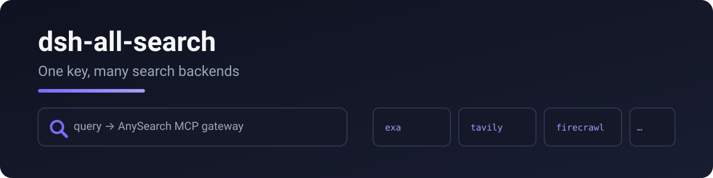

<p align="center">
  
</p>

# dsh-all-search

Adds a web-search provider to DeepSeek Harness, registered into `ctx.web`. AnySearch is a single MCP gateway that aggregates exa / tavily / firecrawl / context7 behind **one API key**. Optional **TinyFish** search adds free news and academic results, and its full-browser fetch can render JavaScript-heavy pages. Optional **DeepSeek** Search/Fetch (`deepseek_api_key`) uses the same Bearer key as the chat API and competes inside the wrapper (not as a second registered search provider).

When `api_key` is set, queries go to that gateway. When it is absent, the same `anysearch` provider stays available and searches via **Firecrawl** `POST /v1/search` with no `Authorization` header (keyless). Set optional `firecrawl_api_key` to send `Authorization: Bearer` and use your own quota. NAT/CI runners that share an egress IP share that keyless daily credit pool.

With `firecrawl_api_key` and an AnySearch key, developer-intent queries (repo / issue / PR / commit / skill) are answered by the **Firecrawl Developer Index** first -- a semantic artifact index over READMEs, issues, PRs, OpenAPI specs and skills -- falling back to AnySearch when it fails or returns nothing.

With `tinyfish_api_key`, news and academic queries route to TinyFish first (`domain_type=news` / `research_paper`), then DeepSeek (if configured), then AnySearch or Firecrawl. Set `tinyfish_fetch: true` / `deepseek_fetch: true` to register those as fetch providers (off by default — Harness already has local fetch, and DeepSeek Search is also built into Harness server-side; this plugin path keeps parity with pi-all-search).

> Port of [pi-all-search](https://github.com/RetiredPhysicist/pi-plugins/tree/main/packages/pi-all-search).

[English](README.md) · [中文](README.zh.md)

## Why

dsh ships Exa / Perplexity / DeepSeek search. This plugin adds AnySearch and anonymous Parallel: one key, many backends, no per-backend credentials. Without an AnySearch key, Firecrawl (and optional DeepSeek/TinyFish) still work so the provider is never a no-op.

## Quick start

```sh
dsh plugin --profile web add dsh-all-search
```

The provider registers as `anysearch` on `ctx.web` -- the built-in `web_search` tool picks it up alongside the stock providers.

```yaml
- id: all-search
  name: dsh-all-search
  config:
    api_key: <your anysearch key>   # optional
```

| key | required | meaning |
|---|---|---|
| `api_key` | - | AnySearch key. When set, queries use the AnySearch gateway. |
| `base_url` | - | MCP endpoint override |
| `firecrawl_api_key` | - | optional Firecrawl key (Bearer quota). Also enables the Developer Index branch for repo/issue/PR/skill queries when AnySearch is configured |
| `tinyfish_api_key` | - | optional TinyFish key. Enables free news/academic search and full-browser fetch. |
| `tinyfish_fetch` | - | register TinyFish as the fetch provider (default `false`; the host usually supplies a local fetch provider) |
| `deepseek_api_key` | - | optional DeepSeek key. Enables DeepSeek Search inside the `anysearch` wrapper (`POST /v1/tools/search`). |
| `parallel_fetch` | - | register anonymous/free Parallel as a fetch provider (default `false`; pin host `fetchProvider` to `parallel` to avoid ambiguity) |
| `deepseek_fetch` | - | register DeepSeek as a fetch provider (default `false`; same reason as `tinyfish_fetch`) |

Without an AnySearch key the provider still reports `available() = true` and searches Firecrawl keyless. Hosts that share an egress IP (NAT, CI) share those daily credits; set `firecrawl_api_key` for a private quota.

Search routing: developer queries → Developer Index → TinyFish (news/academic) → DeepSeek → AnySearch → TinyFish → Firecrawl → anonymous Parallel. Errors/empty results continue to the next source. Every key is optional, so any subset of providers still answers queries.

## Privacy

- Keys live only in your config file -- never logged.
- With `api_key`, only your query and result count go to the AnySearch gateway.
- Without `api_key`, the query goes to Firecrawl `/v1/search`.
- With `tinyfish_api_key`, TinyFish keeps every query and fetched URL under its `/usage` endpoint. Treat it as a non-private retrieval layer.
- With `deepseek_api_key`, queries go to DeepSeek `tools/search` (and optionally `tools/fetch`); same privacy posture as the DeepSeek chat API.

## Development

```bash
npm install
npm run typecheck
npm test          # result parsing / maxResults / HTTP errors / keyless Firecrawl routing
npm run build
```

Live search test:

```bash
node --import tsx tests/real/real-search.mjs
```

## License

MIT

## Parallel: free anonymous fallback

Parallel is included inside the **single** `anysearch` search wrapper, after all existing sources (including keyless Firecrawl) fail or return no results. No extra search provider is registered, avoiding `WEB_PROVIDER_AMBIGUOUS`.

- Fixed official URL: `https://mcp.parallel.ai/mcp?tools=web_search,web_fetch`.
- Never sends Authorization/API-key/cookie headers or reads any Parallel key/environment variable. No OAuth, login, connector install or paid API upgrade.
- Supports JSON and SSE MCP responses. 12-second timeout including response body; caller cancellation; no automatic retries. HTTP 429 applies shared search/fetch Retry-After cooldown (1 second–5 minutes, default 60 seconds). If every source is exhausted, the final error is surfaced rather than charging for a paid upgrade.
- Optional `parallel_fetch: true` registers `parallel` fetch. Leave it off when using the host's local fetch, or pin the host fetch provider explicitly to `parallel`. Do not enable multiple fetch providers without choosing one.
- Anonymous limits are lower and no exact quota is promised. OAuth/API keys are billed at API rates after included credits; they are unsupported by this integration.
- Existing providers and keys are retained. This patch adds **no DeepSeek key** and does not enable its paid API ($0.75/1,000 successful Search or Fetch requests). Existing explicit `deepseek_api_key` behavior is unchanged. A free-only setup must leave existing paid-provider keys unset.
- Build/install this source package and reload dsh to use it; no npm release, remote-machine update or production deployment is performed by this commit.

Docs: https://docs.parallel.ai/integrations/mcp/quickstart
