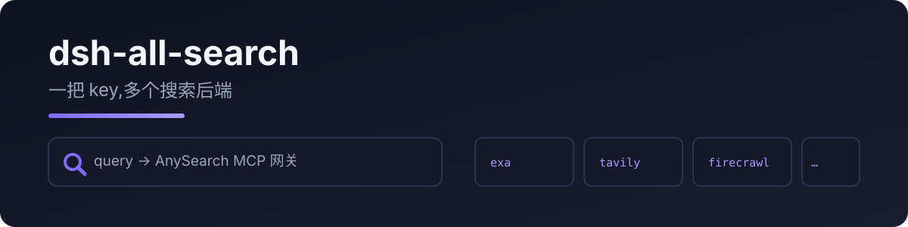

<p align="center">
  
</p>

# dsh-all-search

给 DeepSeek Harness 加一个网页搜索 provider,注册进 `ctx.web`。AnySearch 是单 MCP 网关,一把 API key 聚合 exa / tavily / firecrawl / context7 等多家搜索。可选的 **TinyFish** 补充免费新闻与学术搜索,其全浏览器 Fetch 能渲染 JavaScript 重的页面。可选 **DeepSeek** Search/Fetch（`deepseek_api_key`）与聊天共用 Bearer key，在 wrapper 内竞争（不会再注册第二个 search provider）。

配置了 api_key 时查询走 AnySearch 网关。没有 AnySearch key 时，同一个 anysearch provider 仍可用，改走 Firecrawl POST /v1/search，不带 Authorization（keyless）。若设置可选的 firecrawl_api_key，则发送 Authorization: Bearer 并使用你自己的配额。共享出口 IP 的 NAT/CI 会共用这份无 key 日额度。

设置 tinyfish_api_key 后,新闻与学术查询优先走 TinyFish(`domain_type=news` / `research_paper`),再 DeepSeek（若配置）,再 AnySearch 或 Firecrawl。设置 `tinyfish_fetch: true` / `deepseek_fetch: true` 会注册对应 fetch provider（默认关——宿主通常自带本地 fetch；Harness 服务端也已内置 DeepSeek Search，本插件路径与 pi-all-search 对齐）。

> 由 [pi-all-search](https://github.com/RetiredPhysicist/pi-plugins/tree/main/packages/pi-all-search) 移植。

[English](README.md) · [中文](README.zh.md)

## 为什么需要它

dsh 自带 Exa / Perplexity / DeepSeek 搜索。本插件补 AnySearch:一把 key 多个后端,不用为每家单独配凭据。

## 快速开始

```sh
dsh plugin --profile web add dsh-all-search
```

provider 以 `anysearch` 注册到 `ctx.web`,内置的 `web_search` 工具会自动识别,与自带 provider 并存。

```yaml
- id: all-search
  name: dsh-all-search
  config:
    api_key: <你的 anysearch key>   # 可选
```

| 键 | 必填 | 说明 |
|---|---|---|
| `api_key` | – | AnySearch key。配置后查询走 AnySearch 网关。 |
| `base_url` | – | MCP 端点覆盖 |
| `firecrawl_api_key` | – | 可选 Firecrawl key（Bearer 配额）。配置 AnySearch 时还启用 Developer Index 分支 |
| `tinyfish_api_key` | – | 可选 TinyFish key。启用免费新闻/学术搜索与全浏览器 Fetch |
| `tinyfish_fetch` | – | 把 TinyFish 注册为 fetch provider（默认 `false`,宿主通常自带本地 fetch provider） |
| `deepseek_api_key` | – | 可选 DeepSeek key。在 `anysearch` wrapper 内启用 DeepSeek Search（`POST /v1/tools/search`） |
| `deepseek_fetch` | – | 把 DeepSeek 注册为 fetch provider（默认 `false`，原因同 `tinyfish_fetch`） |

没有 AnySearch key 时 provider 仍 available() = true，走 Firecrawl keyless。共享出口 IP 的 NAT/CI 会共用日额度；需要独立配额时设置 firecrawl_api_key。

搜索路由：开发者查询 → Developer Index → TinyFish（新闻/学术）→ DeepSeek → AnySearch → TinyFish → Firecrawl。每把 key 都可选。

## 隐私

- key 只存在于你的配置文件——不写日志
- 有 api_key 时只向 AnySearch 网关发送查询词和结果数量
- 没有 api_key 时查询发往 Firecrawl /v1/search
- 配置 tinyfish_api_key 后,TinyFish 会在其 `/usage` 端点保留每次查询与抓取的 URL,按非私密检索层对待
- 配置 deepseek_api_key 后,查询发往 DeepSeek `tools/search`（以及可选的 `tools/fetch`）,隐私面与 DeepSeek 聊天 API 相同

## 开发

```bash
npm install
npm run typecheck
npm test          # 结果解析 / maxResults / HTTP 错误 / keyless Firecrawl 路由
npm run build
```

真实搜索测试:

```bash
node --import tsx tests/real/real-search.mjs
```

## License

MIT


## Parallel 免费匿名后备

搜索在所有原有来源（含 Firecrawl）报错或无结果后尝试 Parallel，仍只注册一个搜索包装器，避免多提供商冲突。固定官方 MCP：`https://mcp.parallel.ai/mcp?tools=web_search,web_fetch`。

不读 Parallel key，不发送 Authorization/API-key/Cookie，不登录、不接 OAuth、不自动升级付费；环境里即使有 Parallel key 也忽略。请求含响应体限时 12 秒，可取消，不重试；429 按 Retry-After 冷却 1 秒至 5 分钟（默认 60 秒）。免费匿名额度有限，不保证具体次数或可用性。

抓取可用 `parallel_fetch: true` 显式开启，但默认关闭以保留宿主本地抓取。开启后应将宿主 `fetchProvider` 指定为 `parallel`，不要无选择地同时开启多个抓取来源。

保留原有来源与配置，不添加 DeepSeek key、不启用其收费接口；若原来已显式配置付费来源，它们的行为不变。DeepSeek Search/Fetch 各 $0.75/千次成功请求。纯免费使用需不配置付费来源 key。

本变更仅源码：构建安装后重载 dsh；没有发布 npm、更新远端机器或部署生产。官方说明：https://docs.parallel.ai/integrations/mcp/quickstart
