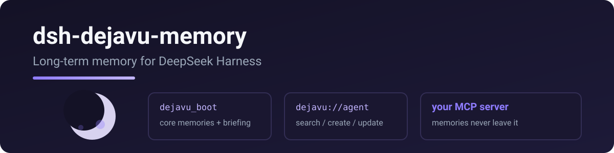

<p align="center">
  
</p>

# dsh-dejavu-memory

Connects DeepSeek Harness to **DejaVu**: session-start boot + daily briefing, plus memory read / search / create / update / delete, backed by your own DejaVu MCP server on Cloudflare.

> Port of [pi-dejavu-memory](https://github.com/RetiredPhysicist/pi-plugins/tree/main/packages/pi-dejavu-memory) — same protocol, same tool names.

The [OpenAI/Codex plugin](https://github.com/RetiredPhysicist/openai-plugins/tree/main/plugins/dejavu-memory) is the only client that opens the interactive memory graph. dsh uses the same server through tools only, with no graph UI and no user-facing MCP setup.

<p align="center">
  
</p>

<p align="center">
  
</p>

[English](README.md) · [中文](README.zh.md)

## Tools

| tool | what it does |
|---|---|
| `dejavu_boot` | load at session start: `system://boot`, `system://recent/5`, `system://triggers`, then best-effort `system://briefing`; afterward read `system://focus` (recent is a briefing subset — no need to re-read it after boot) |
| `dejavu_read` | read a memory by URI (`system://…`, `dejavu://agent`, …) |
| `dejavu_search` | search memories (semantic + keyword / trigger recall via `search_memory`) |
| `dejavu_create` | create a memory node (`[Baseline]`/`[Deviation]`/`[Result]`/`[Reusable judgment]`) |
| `dejavu_update` | full replace, patch (old_string/new_string), or append; optional `relation` |
| `dejavu_delete` | delete a memory by URI (`delete_memory`) |

## Quick start

```sh
dsh plugin --profile web add dsh-dejavu-memory
```

Requires your own DejaVu MCP server on Cloudflare.

```yaml
- id: dejavu
  name: dsh-dejavu-memory
  config:
    mcp_url: https://dejavu.example.com/mcp
    mcp_auth: ""  # prefer mcp_headers for Access service token
```

For a server behind Cloudflare Access (e.g. dejavu.example.com), use the **service token** headers instead of `mcp_auth`:

```yaml
- id: dejavu
  name: dsh-dejavu-memory
  config:
    mcp_url: https://dejavu.example.com/mcp
    mcp_headers:
      CF-Access-Client-Id: <your client id>
      CF-Access-Client-Secret: <your client secret>
```

| key | required | meaning |
|---|---|---|
| `mcp_url` | yes | your DejaVu MCP endpoint (Streamable HTTP) |
| `mcp_auth` | no | legacy; prefer `mcp_headers` for Cloudflare Access service token |
| `mcp_headers` | no | extra headers merged into every MCP request (e.g. Cloudflare Access service token) |

## Tool naming

The `dejavu_boot` / `dejavu_read` prefixes make the memory tools explicit in the tool list and in the boot protocol, so agents call them directly instead of probing for a generic resource first.

## License

MIT

## Related

- [dejavu-memory for ChatGPT and Codex](https://github.com/RetiredPhysicist/openai-plugins/tree/main/plugins/dejavu-memory) — same memory server, with the interactive graph UI
- [pi-dejavu-memory](https://github.com/RetiredPhysicist/pi-plugins/tree/main/packages/pi-dejavu-memory) — same memory tools for Pi
